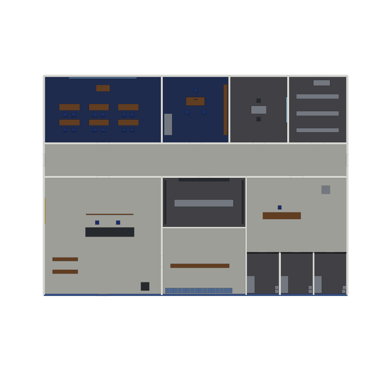

# Интерьер полицейского департамента для SA-MP

Процедурная 3D-модель: один этаж 36 × 26 м, потолок 3.2 м, всё в метрах, Z вверх (как в GTA SA).

## Помещения
| Помещение | Область (x, y) | Что внутри |
|---|---|---|
| Холл | 0–14, 0–14 | вход (юг, x=7), стойка приёма, 2 места, скамьи |
| Раздевалка | 14–24, 0–8 | шкафчики, скамья |
| Оружейная | 14–24, 8–14 | стойки, стол выдачи |
| Зал камер + 3 камеры | 24–36, 0–14 | решётки, нары, санузлы, стойка бронирования |
| Коридор | 0–36, 14–18 | выходы запад/восток (y=16) |
| Брифинг | 0–14, 18–26 | 6 столов, кафедра, экран |
| Кабинет шефа | 14–22, 18–26 | стол, кресла, шкаф |
| Допросная | 22–29, 18–26 | стол, 2 стула, зеркало |
| Улики | 29–36, 18–26 | 3 стеллажа, стол |

## Файлы
- `generate_pd.py` — генератор (только stdlib). Все размеры правятся в коде, затем `python3 generate_pd.py`.
- `pd_interior.obj` / `.mtl` — модель, 15 материалов (цвета), ~1900 граней.
- `pd_interior_boxes.json` — 87 боксов для коллизии.
- `pd_interior.pwn` — filterscript: подключение модели и команда `/pd`.
- `preview.py` — превью сверху (нужен matplotlib).

## Как получить .dff для сервера
Прямую запись `.dff/.txd/.col` я здесь не проверял, поэтому конвертация идёт через Blender:
1. Blender + аддон **DragonFF** (импорт/экспорт DFF/COL).
2. `File → Import → Wavefront (.obj)`, **Forward = Y, Up = Z**, масштаб 1.
3. Назначьте текстуры вместо цветов материалов (по желанию; для .txd используйте TXD Workshop/Magic.TXD).
4. Экспорт `pd_interior.dff`; коллизию — из боксов или DragonFF → COL.
5. Положите в `models/`, подключите через `AddSimpleModel` (open.mp) или артворк-стример для 0.3.DL.

Ограничения: у DFF для SA предел ~65k вершин на геометрию — здесь ~2.5k, запас большой.
Двери, окна и освещение (ночные цвета вершин) не добавлялись; проёмы 1.4 × 2.3 м под двери — стандартные объекты GTA (например, 1569/1493).
