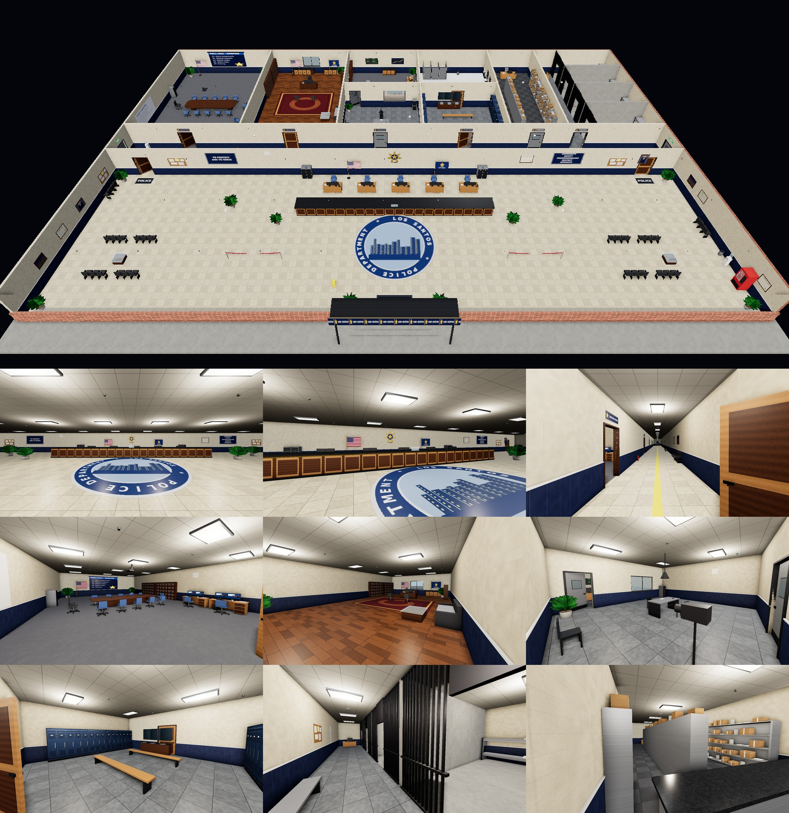

# Интерьер LSPD для SA-MP (по референсу)

Здание 56 × 36 м, потолок 3,4 м, метры, Z вверх. Планировка: широкое лобби с печатью на полу, стойка с 5 рабочими
местами, коридор, ряд служебных помещений и блок камер.

| Помещение | Что внутри |
|---|---|
| Лобби | печать на полу, стойка, мониторы, флаги, герб, кресла ожидания, ограждения, автомат, растения |
| Коридор | двери с табличками, скамьи, огнетушители, камеры, выходы |
| Брифинг | конференц-стол, проектор/экран, доска, рабочие места, кофе-точка |
| Кабинет шефа | стол, ковёр, шкафы, диван, флаги, кредензы |
| Допросная + наблюдение | стол, камера, зеркало-окно, пульт с мониторами CCTV |
| Раздевалка + санузел | шкафчики, скамьи, кабинки, раковины, писсуары |
| Улики | стеллажи с коробками, стойка |
| Содержание | проход, стол оформления, 4 камеры с решётками, нары, санузлы |

## Файлы
- `generate_pd.py` — планировка и расстановка; `pd_lib.py`, `pd_props.py` — примитивы и мебель.
- `gen_textures.py`, `gen_textures2.py` — 60+ текстур PNG (`textures/`, в т.ч. с альфой для растений и печати).
- `pd_interior.obj/.mtl` — модель (UV, нормали, текстуры), `pd_interior_boxes.json` — боксы коллизии, `scene.json` — материалы и светильники.
- `render/` — рендер превью (three.js + Chromium + GTAO): `node render/render.mjs <путь к three> <папка вывода> [кадры]`.
- `preview_photo.jpg` — итоговое превью, `preview/` — отдельные кадры, `pd_interior.pwn` — filterscript (`/pd`).

Пересборка: `python3 gen_textures.py && python3 generate_pd.py`.

## В игру
Вершины в OBJ не склеены (по 4 на грань, ~100k) — для `.dff` разбейте по комнатам (лимит ~65k на геометрию) и склейте
вершины в Blender (Merge by Distance). Конвертация: Blender + DragonFF, текстуры → `.txd` (Magic.TXD), коллизия — из
боксов. Рендер превью — это three.js с AO и тенями, а не движок GTA: в игре картинка будет проще.
